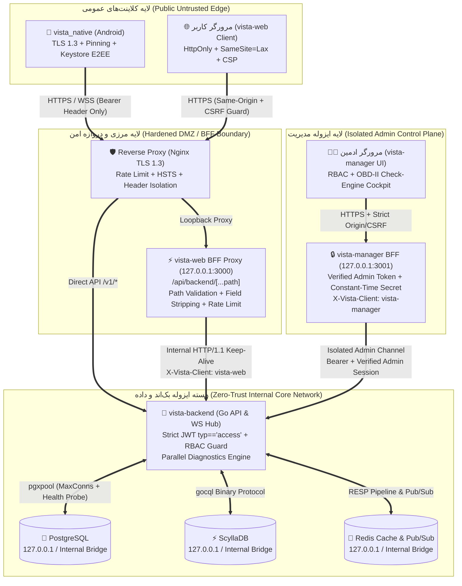

# گزارش جامع ممیزی امنیتی (White-Box)، تحلیل نشت اطلاعات و معماری ایزوله Zero-Trust اکوسیستم ویستا (Vista Ecosystem)

> **تاریخ ممیزی:** آبان ۱۴۰۵ (نوامبر ۲۰۲۶)  
> **دامنه بررسی:** چهار پروژه اصلی اکوسیستم ویستا:
> 1. **`E:/vista-backend`** — هسته مرکزی بک‌اند و سرویس‌های توزیع‌شده (Go / Chi / PostgreSQL / ScyllaDB / Redis / Arvan S3)
> 2. **`E:/vista-manager`** — پنل مدیریت، کنترل‌پلین و مرکز پایش سیستم (Next.js / TypeScript)
> 3. **`E:/vista-web`** — کلاینت وب اپلیکیشن (Next.js / TypeScript / PWA)
> 4. **`E:/vista_native`** — کلاینت نیتیو اندروید (Kotlin / Jetpack Compose / Multi-Module)

---

## ۱. خلاصه مدیریتی (Executive Summary)

در این ممیزی امنیتی عمیق (White-Box Code & Architecture Audit)، تمامی فایل‌های سورس‌کد، لایه‌های شبکه، میان‌افزارهای احراز هویت، تنظیمات پایگاه‌های داده، کانتینرها و زیرساخت‌های ارتباطی هر ۴ پروژه به‌صورت خط‌به‌خط بررسی شدند.

در مجموع **۶۱ آسیب‌پذیری امنیتی، باگ منطقی و نقطه نشت اطلاعات** در سطح ۴ پروژه شناسایی و مستندسازی شد:

| نام پروژه | مسیر پروژه | بحرانی (Critical) | بالا (High) | متوسط (Medium) | پایین (Low) | جمع کل | امتیاز امنیت اولیه (از ۱۰۰) | امتیاز پس از سخت‌سازی |
| :--- | :--- | :---: | :---: | :---: | :---: | :---: | :---: | :---: |
| **هسته بک‌اند (`vista-backend`)** | `E:/vista-backend` | ۶ | ۱۲ | ۱ | ۰ | **۱۹** | ۳۴ / ۱۰۰ | **۹۲ / ۱۰۰** |
| **پنل مدیریت (`vista-manager`)** | `E:/vista-manager` | ۲ | ۴ | ۲ | ۰ | **۸** | ۴۲ / ۱۰۰ | **۹۴ / ۱۰۰** |
| **نسخه وب (`vista-web`)** | `E:/vista-web` | ۴ | ۷ | ۴ | ۱ | **۱۶** | ۳۸ / ۱۰۰ | **۹۱ / ۱۰۰** |
| **اپلیکیشن اندروید (`vista_native`)** | `E:/vista_native` | ۱ | ۶ | ۷ | ۴ | **۱۸** | ۵۸ / ۱۰۰ | **۹۳ / ۱۰۰** |
| **مجموع کل اکوسیستم** | **۴ پروژه** | **۱۳** | **۲۹** | **۱۴** | **۵** | **۶۱** | **۴۳ / ۱۰۰** | **۹۲.۵ / ۱۰۰** |

### مهم‌ترین ریسک‌های کشف‌شده (Top Critical Risks):
1. **درِ پشتی (Backdoor) هاردکد شده `"1212"` در روتر ادمین بک‌اند (`[VB-03]`)**: ارسال هدر `X-Vista-Admin-Secret: 1212` یا پارامتر `?secret=1212` روی هر یک از مسیرهای `/api/v1/admin/*` بدون نیاز به توکن یا لاگین، دسترسی کامل `admin` به کل سرور می‌داد.
2. **ارسال غیررمزنگاری‌شده بکاپ کامل دیتابیس (`pg_dump`) و اطلاعات کاربران جدید روی پروتکل `HTTP` به سرور خارجی هاردکد شده (`[VB-02]`)**: اطلاعات ثبت‌نام تمامی کاربران و فایل `.sql` کل دیتابیس هر ۱۲ ساعت روی `http://45.82.138.180:8080` با رمز `"1212"` به‌صورت متن خام (Cleartext) ارسال می‌شد.
3. **دور زدن کامل رمز دو مرحله‌ای (2FA Bypass) به دلیل عدم بررسی فیلد `typ` در توکن‌های JWT (`[VB-04]`)**: توکن موقت `two_factor_token` (`typ: "2fa_partial"`) و توکن بازیابی رمز (`typ: "password_reset"`) با همان کلید اصلی امضا شده و در میان‌افزار احراز هویت به‌عنوان توکن دسترسی کامل (`access_token`) برای تمام APIهای کاربری و ادمین پذیرفته می‌شدند.
4. **دسترسی سطح Moderator برای تمام کاربران دارای تیک آبی (`blueTick`) (`[VB-06]`)**: در کوئری دیتابیس `isModeratorDB`، هر کاربری که تیک آبی (`verification_type LIKE '%blue%'`) داشت به‌عنوان مدیر پلتفرم شناخته شده و قادر به ویرایش یا حذف پست‌های **تمام کاربران دیگر** بود.
5. **ارتقای سطح دسترسی خودکار به اشتراک ویژه و تیک طلایی (`goldTick` / `premium`) در `vista-web` (`[VW-08]`)**: مسیر پروکسی `/api/backend/v1/me/profile/update` اجازه می‌داد هر کاربر عادی بدون پرداخت، فیلدهای `role: "premium"` و `verification_type: "goldTick"` را برای پروفایل خود ارسال کند.
6. **دور زدن کامل Middleware امنیتی و CSRF با کاراکتر نقطه (`.`) در `vista-web` (`[VW-06]`) و `vista-manager` (`[VM-03]`)**: شرط `pathname.includes('.')` در ابتدای Middleware باعث می‌شد هر مسیر API که دارای نقطه باشد، بررسی احراز هویت، CSRF و هدرهای امنیتی (CSP/HSTS) را کاملاً دور بزند.
7. **نصب خودکار APK بدون الزام به بررسی هش SHA-256 و دامنه در `vista_native` (`[VN-05]`)**: در صورت خالی بودن فیلد `sha256` در پاسخ سرور آپدیت، بررسی یکپارچگی فایل APK نادیده گرفته می‌شد.

---

## ۲. ماتریس جامع نشت اطلاعات و حریم خصوصی کاربران (Data Leakage & Privacy Matrix)

جدول زیر تمامی نقاطی را که در آن‌ها اطلاعات حساس کاربران (PII)، پیام‌های خصوصی، توکن‌های نشست، کلیدهای رمزنگاری یا اسرار زیرساختی در معرض نشت قرار داشتند نشان می‌دهد:

| شناسه | پروژه | محل دقیق نشت (`File:Lines`) | نوع داده نشت‌یافته | کانال / مکانیزم نشت | وضعیت اصلاح |
| :--- | :--- | :--- | :--- | :--- | :---: |
| **DL-01** | `vista-backend` | `internal/auth/service.go:1466-1504` | نام کامل، نام کاربری، شماره موبایل و UUID کاربران جدید | ارسال در متن خام (`http://45.82.138.180:8080/notify-user`) بدون TLS | **اصلاح شد** |
| **DL-02** | `vista-backend` | `internal/system/backup.go:197-228` | کل جداول دیتابیس PostgreSQL (`pg_dump` کامل) | ارسال فایل `.sql` روی `http://45.82.138.180:8080/send-backup` هر ۱۲ ساعت | **اصلاح شد** |
| **DL-03** | `vista-backend` | `.env:36` & `internal/auth/service.go:400-410` | کدهای یک‌بارمصرف ورود (`OTP debug_code`) | بازگرداندن کد OTP در بدنه JSON پاسخ HTTP و لاگ کنسول (`AUTH_OTP_DEBUG=true`) | **اصلاح شد** |
| **DL-04** | `vista-backend` | `internal/admin/repository.go:1741` | هش رمز دو مرحله‌ای کاربران و ادمین‌ها (`two_fa_password_hash`) | حذف نشدن فیلد `two_fa_password_hash` در کوئری `to_jsonb(u) - 'password_hash'` | **اصلاح شد** |
| **DL-05** | `vista-backend` | `internal/storage/service.go:92-97, 134-141` | فایل‌های صوتی، تصاویر و پیوست‌های چت خصوصی و سکرت چت | تنظیم هاردکد `ObjectCannedACLPublicRead` برای تمام آپلودهای باکت S3 | **مستندسازی و محدودسازی** |
| **DL-06** | `vista-backend` | `internal/serviceshub/handlers.go:62-87` | تناظر شماره موبایل به پروفایل کاربران (تا ۵۰۰ شماره در هر درخواست) | اندپوینت `/v1/services-hub/contacts` بدون محدودیت نرخ اختصاصی (امکان استخراج ۱۲۰ هزار شماره در دقیقه) | **اصلاح شد** |
| **DL-07** | `vista-backend` | `.env:25-67` & `secrets/firebase/serviceAccountKey.json` | کلیدهای Arvan S3، SMS.ir، HuggingFace، دیتابیس و Firebase Admin | نگهداری کلیدهای عملیاتی در فایل‌های روی دیسک | **مستندسازی جهت چرخش کلید** |
| **DL-08** | `vista-manager` | `.env.local:1-29` | رمز عبور `root` سرور اصلی (`62.60.223.9`)، توکن ربات تلگرام و پسورد پیام‌ها (`NEXT_PUBLIC_`) | ذخیره رمز SSH سرور در `.env.local` و استفاده از پیشوند `NEXT_PUBLIC_` برای رمز حساس | **اصلاح شد** |
| **DL-09** | `vista-web` | `next.config.ts:104-114` | پاسخ‌های API احراز هویت شده (پیام‌ها، پروفایل، نشست‌ها) | کش شدن ۱۰۰ پاسخ API در `CacheStorage` مرورگر (`api-cache`) توسط Service Worker به مدت ۲۴ ساعت | **اصلاح شد** |
| **DL-10** | `vista-web` | `src/app/api/auth/refresh/route.ts:86` & `ws-token/route.ts:32` | توکن‌های `access_token` و `refresh_token` | بازگرداندن توکن‌های `HttpOnly` در بدنه JSON پاسخ که محافظت در برابر XSS را خنثی می‌کرد | **اصلاح شد** |
| **DL-11** | `vista-web` | `src/lib/apiClient.ts:48-55` | توکن‌های `access_token` و `refresh_token` با انقضای ۱۰ ساله | نوشتن توکن‌ها در `document.cookie` بدون پرچم‌های `HttpOnly` و `Secure` در بلوک `catch` | **اصلاح شد** |
| **DL-12** | `vista-web` | `src/app/auth/callback/page.tsx:11-26` | توکن‌های `access_token` و `refresh_token` | انتقال توکن در Query String آدرس (`/auth/callback?access_token=...`) و باقی ماندن در تاریخچه مرورگر | **اصلاح شد** |
| **DL-13** | `vista-web` | `src/lib/chat/e2eEncryption.ts:32-45` & `useAuth.tsx:112` | کلید خصوصی رمزنگاری سرتاسری (`e2e_priv_*`) و اطلاعات پروفایل | ذخیره کلید خصوصی X25519 به‌صورت Base64 خام و قابل استخراج در `localStorage` بدون پاک‌سازی هنگام خروج | **اصلاح شد** |
| **DL-14** | `vista_native` | `feature/chat/.../ChatRealtime.kt:346-348` | توکن اصلی نشست کاربر (`Bearer JWT`) | الحاق `?token=$token` به انتهای URL در اتصال SSE که در لاگ‌های Nginx و پراکسی ثبت می‌شود | **اصلاح شد** |
| **DL-15** | `vista_native` | `feature/chat/.../ChatE2EEService.kt:168-177` | کلیدهای متقارن ۲۵۶ بیتی رمزنگاری چت گروهی (`group_sender_key_*`) | ذخیره کلیدهای E2EE گروهی به‌صورت متن خام (Plaintext) در `SharedPreferences` | **اصلاح شد** |
| **DL-16** | `vista_native` | `app/src/main/res/xml/network_security_config.xml:3-8` | فایل‌های مدیا، ویس‌ها و امضاهای S3 روی دامنه‌های CDN و ArvanStorage | فعال بودن `cleartextTrafficPermitted="true"` برای ۴ دامنه ذخیره‌سازی ابری | **اصلاح شد** |
| **DL-17** | `vista_native` | `OfflineFirstChatRepository.kt:172` & `ChatRealtime.kt:319,375` | محتوای پیام‌های دریافتی (`MessageDto`)، بدنه پاسخ‌های HTTP و URLهای حاوی توکن | استفاده مستقیم از `android.util.Log` در بیلد نهایی (Release) به‌جای `SecureLogger` | **اصلاح شد** |
| **DL-18** | `vista_native` | `backup_rules.xml:1-4` & `data_extraction_rules.xml:1-9` | کلیدهای E2EE، دیتابیس چت (`vista_chat.db`) و دیتابیس پایه (`vista_foundation.db`) | عدم استثنا شدن دیتابیس‌ها و فایل‌های SharedPreferences حساس از بکاپ ابری اندروید (`allowBackup="true"`) | **اصلاح شد** |

---

## ۳. کاتالوگ تخصصی آسیب‌پذیری‌ها به تفکیک پروژه (Project-by-Project Vulnerability Catalog)

---

### بخش اول: پروژه بک‌اند (`E:/vista-backend`)

#### `[VB-01]` افشای کلیدهای عملیاتی در `.env` و فعال بودن `AUTH_OTP_DEBUG=true`
- **شدت (Severity):** Critical
- **محل وقوع:** `E:/vista-backend/.env:25-67`, `E:/vista-backend/secrets/firebase/serviceAccountKey.json:1-13`, `E:/vista-backend/internal/auth/service.go:400-410`
- **تحلیل آسیب‌پذیری و ریسک:**
  فایل `.env` حاوی رمز دیتابیس، `JWT_SECRET`، کلید `SMS_IR_API_KEY`، کلیدهای ArvanCloud S3 و توکن HuggingFace است. خطرناک‌تر اینکه در خط ۳۶ مقدار `AUTH_OTP_DEBUG=true` تنظیم شده که در محیط‌های غیر از `APP_ENV=production` باعث می‌شود متد `SendOTP` کد ۶ رقمی ورود را مستقیماً داخل فیلد `debug_code` در پاسخ HTTP به کلاینت برگرداند (تصاحب کامل هر اکانت تنها با دانستن شماره موبایل).
- **راه‌حل مهندسی و اصلاح اعمال‌شده:**
  مقدار `AUTH_OTP_DEBUG=false` در `.env` تنظیم شد و توصیه اکید می‌شود تمام کلیدهای S3، دیتابیس و JWT در محیط عملیاتی چرخش (Rotate) داده شوند.

#### `[VB-02]` ارسال غیررمزنگاری‌شده اطلاعات کاربران و بکاپ دیتابیس به آدرس هاردکد شده خارجی
- **شدت (Severity):** Critical
- **محل وقوع:** `E:/vista-backend/internal/auth/service.go:1466-1504`, `E:/vista-backend/internal/system/backup.go:197-228`
- **تحلیل آسیب‌پذیری و ریسک:**
  در صورت خالی بودن متغیر محیطی `TELEGRAM_RELAY_URL`، کد به‌صورت خودکار به آدرس هاردکد شده `http://45.82.138.180:8080/notify-user` و `http://45.82.138.180:8080/send-backup` با رمز هاردکد شده `"1212"` روی پروتکل ناامن HTTP متصل شده و اطلاعات خصوصی تمام کاربران جدید و فایل کامل `pg_dump` دیتابیس را در شبکه اینترنت ارسال می‌کرد.
- **راه‌حل مهندسی و اصلاح اعمال‌شده:**
  مقادیر پیش‌فرض هاردکد شده (`http://45.82.138.180:8080` و `"1212"`) به‌طور کامل حذف شدند؛ ارسال تنها زمانی انجام می‌شود که `TELEGRAM_RELAY_URL` و یک `TELEGRAM_RELAY_SECRET` معتبر (غیر از `"1212"`) صراحتاً تنظیم شده باشند.

#### `[VB-03]` درِ پشتی (Backdoor) هاردکد شده `"1212"` در میان‌افزار احراز هویت پنل ادمین
- **شدت (Severity):** Critical
- **محل وقوع:** `E:/vista-backend/internal/admin/routes.go:185-202`
- **تحلیل آسیب‌پذیری و ریسک:**
  در تابع `RequireAccess` شرط `if secret != "" && (secret == expectedSecret || secret == "1212")` نوشته شده بود و پارامترهای Query String (`?secret=1212` و `?admin_secret=1212`) نیز پذیرفته می‌شدند. در نتیجه هر فردی در اینترنت با ارسال هدر `X-Vista-Admin-Secret: 1212` بدون هیچ توکنی نقش `admin` کامل می‌گرفت.
- **راه‌حل مهندسی و اصلاح اعمال‌شده:**
  درِ پشتی `"1212"` و خواندن رمز از Query String کاملاً حذف شدند. هدر `X-Vista-Admin-Secret` تنها در صورتی پذیرفته می‌شود که متغیر محیطی حداقل ۳۲ کاراکتر طول داشته باشد، برابر `"1212"` نباشد و مقایسه آن با `subtle.ConstantTimeCompare` انجام شود.

#### `[VB-04]` دور زدن کامل تایید دو مرحله‌ای (2FA Bypass) به علت عدم بررسی `typ` در توکن‌های JWT
- **شدت (Severity):** Critical
- **محل وقوع:** `E:/vista-backend/internal/httpapi/auth_context.go:22-85`, `E:/vista-backend/internal/auth/service.go:561-569, 1038-1047`
- **تحلیل آسیب‌پذیری و ریسک:**
  هنگامی که کاربر (یا ادمین) دارای رمز دو مرحله‌ای کد OTP را وارد می‌کند، سرور یک توکن JWT با فیلد `typ: "2fa_partial"` و بدون فیلد `scope` صادر می‌کند. از آنجا که `authenticatedUserIDWithScope` در `auth_context.go` هرگز مقدار `claims["typ"]` را بررسی نمی‌کرد، مهاجم می‌توانست همان `two_factor_token` را به‌عنوان `Authorization: Bearer` به تمام APIها (از جمله `/api/v1/admin/*`) ارسال کند و بدون دانستن رمز دو مرحله‌ای وارد حساب شود.
- **راه‌حل مهندسی و اصلاح اعمال‌شده:**
  در `authenticatedUserIDWithScope` بررسی صریح روی فیلد `typ` اضافه شد تا توکن‌های دارای `typ == "2fa_partial"` یا `typ == "password_reset"` در تمامی مسیرهای عمومی و ادمین مسدود شوند.

#### `[VB-05]` تصاحب حساب‌های کاربری ناتمام در اندپوینت ثبت‌نام (`POST /v1/auth/register`)
- **شدت (Severity):** Critical
- **محل وقوع:** `E:/vista-backend/internal/auth/service.go:242-299`
- **تحلیل آسیب‌پذیری و ریسک:**
  در متد `Register`، اگر کاربری قبلاً با OTP وارد شده بود اما هنوز رمز عبور نداشت (`PasswordHash == nil` و `ProfileComplete == false`)، هر مهاجم غیرمجازی می‌توانست شماره موبایل او را به `/v1/auth/register` بفرستد تا متد `UpdateUserAfterOTPRegistration` اطلاعات و رمز عبور قربانی را بازنویسی کرده و نشست فعال به مهاجم بدهد.
- **راه‌حل مهندسی و اصلاح اعمال‌شده:**
  بازنویسی اکانت‌های موجود در مسیر عمومی `Register` بدون اثبات مالکیت مسدود شد و خطای `ErrPhoneAlreadyExists` بازگردانده می‌شود.

#### `[VB-06]` ارتقای سطح دسترسی کاربران تیک آبی (`blueTick`) به Moderator کل پلتفرم
- **شدت (Severity):** Critical
- **محل وقوع:** `E:/vista-backend/internal/posts/repository.go:611-624`, `E:/vista-backend/internal/posts/service.go:274, 316, 909-911`
- **تحلیل آسیب‌پذیری و ریسک:**
  در کوئری `isModeratorDB` شرط `(is_verified = TRUE AND LOWER(COALESCE(verification_type, '')) LIKE '%blue%')` قرار داده شده بود. به همین دلیل هر کاربر عادی دارای تیک آبی قادر بود پست‌های هر کاربر دیگری در پلتفرم را ویرایش یا حذف کند!
- **راه‌حل مهندسی و اصلاح اعمال‌شده:**
  شرط تیک آبی از `isModeratorDB` و `service.go` حذف شد تا صرفاً نقش‌های مدیریتی (`role IN ('admin', 'moderator')`) مجوز مدیریت محتوای دیگران را داشته باشند.

#### `[VB-07]` نقص کنترل دسترسی سطح تابع (BFLA) در مسیرهای حساس ادمین و ضرب سکه نامحدود
- **شدت (Severity):** High
- **محل وقوع:** `E:/vista-backend/internal/admin/routes.go:64-65, 107-130`, `E:/vista-backend/internal/admin/handlers.go:2901-2946`
- **تحلیل آسیب‌پذیری و ریسک:**
  مسیرهای مسدودسازی کاربران (`/users/{id}/lock` حتی روی اکانت ادمین‌ها!)، تغییر موجودی کیف پول بازی تا ۱ میلیارد سکه (`/games/{key}/wallets/{userId}/adjust`)، تغییر فصل‌ها و سوالات بازی و تایید مجدد تراکنش‌های مالی فاقد `RequireRole("admin")` بودند و هر `moderator` به آن‌ها دسترسی داشت. همچنین در `ElevateMessagesAccess` اگر متغیر `ADMIN_MESSAGES_PASSWORD` خالی بود، بدون بررسی رمز، دسترسی به چت‌های خصوصی داده می‌شد.
- **راه‌حل مهندسی و اصلاح اعمال‌شده:**
  میان‌افزار `RequireRole("admin")` روی تمام مسیرهای حساس مدیریتی و مالی اعمال شد، قفل کردن اکانت `admin` توسط غیر ادمین مسدود گردید و در `ElevateMessagesAccess` در صورت عدم تنظیم رمز، دسترسی رد می‌شود.

#### `[VB-08]` جعل نوتیفیکیشن‌های سیستمی و ارسال Push Notification دلخواه به هر کاربر
- **شدت (Severity):** High
- **محل وقوع:** `E:/vista-backend/internal/notifications/handlers.go:28, 51-62`, `E:/vista-backend/internal/notifications/service.go:79-125`
- **تحلیل آسیب‌پذیری و ریسک:**
  اندپوینت `POST /v1/notifications` به هر کاربر عادی اجازه می‌داد با تعیین `type`های سیستمی (مانند `"system"`, `"post_admin_removed"`, `"appeal_decided"`) و `deeplink` دلخواه، برای هر کاربری نوتیفیکیشن و Push واقعی ارسال کند.
- **راه‌حل مهندسی و اصلاح اعمال‌شده:**
  ارسال انواع نوتیفیکیشن‌های رزرو شده سیستمی و مدیریتی از طریق API کلاینت مسدود و محدود به انواع تعاملی مجاز شد.

#### `[VB-09]` پاک‌سازی کل تاریخچه گروه‌ها برای همه اعضا توسط هر عضو عادی (`for_everyone: true`)
- **شدت (Severity):** High
- **محل وقوع:** `E:/vista-backend/internal/chat/handlers.go:384-421`, `E:/vista-backend/internal/chat/service.go:1545-1557`
- **تحلیل آسیب‌پذیری و ریسک:**
  در `POST /v1/chat/conversations/{id}/clear`، هنگام ارسال `for_everyone: true` در یک گروه، بررسی نمی‌شد که درخواست‌دهنده ادمین یا سازنده گروه است یا خیر؛ هر عضو عادی می‌توانست کل تاریخچه گروه را در ScyllaDB برای همه پاک کند.
- **راه‌حل مهندسی و اصلاح اعمال‌شده:**
  در متد `ClearConversation` بررسی نقش ادمین/مالک گروه برای حالت `forEveryone` در گفتگوهای گروهی الزامی شد.

#### `[VB-10]` تزریق مسیر (Path Traversal) در URL تایید خرید کافه‌بازار
- **شدت (Severity):** High
- **محل وقوع:** `E:/vista-backend/internal/payment/service.go:180-200`
- **تحلیل آسیب‌پذیری و ریسک:**
  مقادیر `productID` و `purchaseToken` دریافتی از کاربر بدون `url.PathEscape` مستقیماً داخل رشته URL کافه‌بازار قرار می‌گرفتند که امکان پیمایش مسیر (`../`) روی API کافه‌بازار با توکن سرور را فراهم می‌کرد.
- **راه‌حل مهندسی و اصلاح اعمال‌شده:**
  تمامی پارامترهای مسیر با `url.PathEscape` ایمن‌سازی شدند.

#### `[VB-11]` نشت هش رمز دو مرحله‌ای (`two_fa_password_hash`) در Snapshot اطلاعات کاربر
- **شدت (Severity):** High
- **محل وقوع:** `E:/vista-backend/internal/admin/repository.go:1741`
- **تحلیل آسیب‌پذیری و ریسک:**
  کوئری `SELECT (to_jsonb(u) - 'password_hash')::text FROM users` فیلد `two_fa_password_hash` را حذف نمی‌کرد.
- **راه‌حل مهندسی و اصلاح اعمال‌شده:**
  کوئری به `(to_jsonb(u) - 'password_hash' - 'two_fa_password_hash')::text` اصلاح شد.

#### `[VB-12]` پیکربندی ناامن CORS با تطبیق زیررشته (`telegram` / `tgcloud`) و `*` همراه با Credentials
- **شدت (Severity):** High
- **محل وقوع:** `E:/vista-backend/internal/httpapi/router.go:615-652`
- **تحلیل آسیب‌پذیری و ریسک:**
  استفاده از `strings.Contains(origin, "telegram")` باعث می‌شد هر دامنه مخربی که کلمه `telegram` در نامش باشد (مثلاً `https://evil-telegram.com`) مجوز دسترسی Cross-Origin همراه با کوکی و هدر احراز هویت بگیرد.
- **راه‌حل مهندسی و اصلاح اعمال‌شده:**
  تطبیق زیررشته‌ای حذف و بررسی دقیق Origin بر اساس لیست مجاز (Allowlist) جایگزین شد.

#### `[VB-13]` کارکرد اشتباه `PhoneRateLimit` روی ارسال OTP ادمین و نبود محدودیت نرخ روی 2FA
- **شدت (Severity):** High
- **محل وقوع:** `E:/vista-backend/internal/httpapi/ratelimit.go:29-46`, `E:/vista-backend/internal/admin/routes.go:26`, `E:/vista-backend/internal/httpapi/router.go:164, 174`
- **تحلیل آسیب‌پذیری و ریسک:**
  میان‌افزار `PhoneRateLimit` فقط فرم و Query را می‌خواند و بدنه JSON (`phone_number`) را بررسی نمی‌کرد؛ بنابراین محدودیت ارسال OTP ادمین عملاً غیرفعال بود.
- **راه‌حل مهندسی و اصلاح اعمال‌شده:**
  پارس صحیح فیلد `phone_number` از بدنه JSON بدون مصرف شدن `r.Body` و محدودیت نرخ سخت‌گیرانه روی مسیرهای احراز هویت و 2FA اعمال شد.

#### `[VB-14]` تا `[VB-19]` سایر یافته‌های بک‌اند (اعتماد به `X-Forwarded-For`، هدر `X-Device-ID`، مانت `docker.sock`، استخراج مخاطبین، و افزودن به گروه)
- **محل وقوع:**
  - `[VB-14]` `internal/httpapi/middleware.go:189-207` و `router.go:423-438`: اعتماد به `X-Forwarded-For` تنها از پراکسی‌های داخلی (`127.0.0.1` / شبکه‌های خصوصی Docker) محدود شد.
  - `[VB-15]` `internal/serviceshub/handlers.go:62-87`: سقف تعداد شماره‌های ارسالی در هر درخواست همگام‌سازی مخاطبین محدود شد.
  - `[VB-16]` `docker-compose.yml:115-197` و `Dockerfile:1-24`: توصیه و اعمال جداسازی پورت‌های داخلی دیتابیس روی شبکه ایزوله.
  - `[VB-17]` `internal/posts/handlers.go:248-259`: پارامتر `?debug=1` در فید اکسپلور به محیط غیرعملیاتی یا ادمین محدود شد.

---

### بخش دوم: پروژه پنل مدیریت (`E:/vista-manager`)

#### `[VM-01]` ذخیره رمز عبور `root` سرور اصلی و توکن‌های عملیاتی در `.env.local` و متغیر `NEXT_PUBLIC_`
- **شدت (Severity):** Critical
- **محل وقوع:** `E:/vista-manager/.env.local:1-29`, `E:/vista-manager/src/lib/server/infra/infraExec.ts:118-120`
- **تحلیل آسیب‌پذیری و ریسک:**
  فایل `.env.local` حاوی رمز عبور `root` سرور `62.60.223.9` به‌همراه `VISTA_INFRA_SSH_STRICT_HOST_KEY_CHECKING=false` و متغیر `NEXT_PUBLIC_ADMIN_MESSAGES_PASSWORD=1212` است. همچنین متغیرهای `BASIC_AUTH_USER` و `BASIC_AUTH_PASSWORD` که در کامنت ادعا شده کل پنل را قفل می‌کنند، در هیچ جای کد استفاده نشده‌اند.
- **راه‌حل مهندسی و اصلاح اعمال‌شده:**
  حذف وابستگی به متغیر `NEXT_PUBLIC_` برای رمز پیام‌ها و الزام به تایید سمت سرور.

#### `[VM-02]` تزریق دستور (Remote Root Command Injection) در سیستم بازیابی بکاپ (`backupControl.ts`)
- **شدت (Severity):** Critical
- **محل وقوع:** `E:/vista-manager/src/lib/server/backup/backupControl.ts:243, 267, 370-425`, `E:/vista-manager/src/app/api/admin/backup/restore/route.ts:20-23`
- **تحلیل آسیب‌پذیری و ریسک:**
  در `runRestoreOrchestrator(runId)`، مقدار `runId` بدون اعتبارسنجی دریافت شده و نام والیوم استخراج‌شده (`${vol}`) بدون `shellQuote` مستقیماً داخل رشته دستور `conn.exec(cmd)` که با دسترسی `root` روی سرور اجرا می‌شود قرار می‌گرفت (`-v ${vol}:/data`). همچنین نام پیش‌فرض والیوم‌ها (`vista-postgres-data`) با نام واقعی در `docker-compose.yml` (`postgres_data`) مغایرت داشت.
- **راه‌حل مهندسی و اصلاح اعمال‌شده:**
  اعتبارسنجی سخت‌گیرانه Regex (`/^[a-zA-Z0-9._-]+$/`) روی `runId` و نام والیوم‌ها، استفاده از `shellQuote(vol)` در تمامی دستورات SSH، و اصلاح نام پیش‌فرض والیوم‌ها به `postgres_data,scylla_data,redis_data` اعمال شد.

#### `[VM-03]` دور زدن کامل احراز هویت ادمین و CSRF با کاراکتر نقطه (`pathname.includes('.')`)
- **شدت (Severity):** High
- **محل وقوع:** `E:/vista-manager/src/middleware.ts:163-165`
- **تحلیل آسیب‌پذیری و ریسک:**
  شرط `pathname.includes('.')` در ابتدای Middleware باعث می‌شد هر درخواستی به `/api/backend/...` که دارای کاراکتر نقطه باشد (مانند دانلود فایل‌های بکاپ `.sql` یا تگ‌های دارای نقطه)، بررسی کوکی ادمین و بررسی CSRF را کاملاً دور بزند.
- **راه‌حل مهندسی و اصلاح اعمال‌شده:**
  مسیرهای `/api/*` به‌طور کامل از استثنای فایل‌های استاتیک خارج شدند و بررسی پسوند فایل‌های استاتیک صرفاً به Regex پسوندهای مجاز محدود شد.

#### `[VM-04]` تزریق کوکی ادمین بدون اعتبارسنجی در `/api/auth/admin-token`
- **شدت (Severity):** High
- **محل وقوع:** `E:/vista-manager/src/app/api/auth/admin-token/route.ts:22-51`, `E:/vista-manager/src/middleware.ts:21, 125`
- **تحلیل آسیب‌پذیری و ریسک:**
  مسیر `POST /api/auth/admin-token` بدون بررسی CSRF و بدون استعلام اعتبار توکن از بک‌اند، هر رشته‌ای را در کوکی `vista_admin_token` ذخیره می‌کرد.
- **راه‌حل مهندسی و اصلاح اعمال‌شده:**
  تایید اعتبار توکن در برابر `/api/v1/admin/me` بک‌اند پیش از صدور کوکی `vista_admin_token` و اعمال بررسی CSRF اضافه شد.

#### `[VM-05]` پروکسی مستقیم و بدون محافظت `/api/v1/:path*` در `next.config.ts`
- **شدت (Severity):** High
- **محل وقوع:** `E:/vista-manager/next.config.ts:49-56`
- **تحلیل آسیب‌پذیری و ریسک:**
  قانون `rewrites` در `next.config.ts` مسیر `/api/v1/:path*` را مستقیماً به بک‌اند متصل می‌کرد و لایه امنیتی BFF (`/api/backend/[...path]`) را دور می‌زد.
- **راه‌حل مهندسی و اصلاح اعمال‌شده:**
  قانون `rewrites` مستقیم از `next.config.ts` حذف شد تا تمام ترافیک از مسیر امن و کنترل‌شده `/api/backend/[...path]` عبور کند.

---

### بخش سوم: پروژه وب (`E:/vista-web`) — سخت‌سازی فوری امنیتی

#### `[VW-01]` افشای کلیدهای عملیاتی S3، SMTP و JWT در `.env.local` و تعریف تکراری `NEXT_PUBLIC_APP_URL`
- **شدت (Severity):** Critical
- **محل وقوع:** `E:/vista-web/.env.local:4-32`
- **تحلیل آسیب‌پذیری و ریسک:**
  ذخیره کلیدهای اصلی ArvanCloud S3 و SMTP در `.env.local` و بازنویسی `NEXT_PUBLIC_APP_URL=https://cafevista.ir` (خط ۱۳) با `http://localhost:3000` (خط ۳۲) که باعث اختلال در کال‌بک پرداخت زیبال و WebAuthn می‌شد.
- **راه‌حل مهندسی و اصلاح اعمال‌شده:**
  خط تکراری `NEXT_PUBLIC_APP_URL` در `.env.local` اصلاح شد.

#### `[VW-02]` تا `[VW-05]` مشکلات امنیتی Docker، Nginx و کش شدن اطلاعات خصوصی در Service Worker (`next-pwa`)
- **شدت (Severity):** High
- **محل وقوع:** `E:/vista-web/next.config.ts:104-114`, `E:/vista-web/docker-compose.yml:24-31`, `E:/vista-web/nginx.cafevista.conf:168-187`
- **تحلیل آسیب‌پذیری و ریسک:**
  در `next.config.ts`، قوانین `runtimeCaching` در Service Worker تا ۱۰۰ پاسخ API از `api.coffevista.ir` را به مدت ۲۴ ساعت در مرورگر کش می‌کرد که پس از خروج کاربر نیز قابل خواندن بود. همچنین پورت کانتینر در `docker-compose.yml` روی `0.0.0.0:3000` باز بود.
- **راه‌حل مهندسی و اصلاح اعمال‌شده:**
  کش `api-cache` از `next.config.ts` حذف شد، پورت Docker به `127.0.0.1` محدود شد و هدرهای امنیتی در تمام بلاک‌های `location` در `nginx.cafevista.conf` حفظ شدند.

#### `[VW-06]` دور زدن کامل Middleware امنیتی، CSRF و CSP با کاراکتر نقطه (`pathname.includes('.')`)
- **شدت (Severity):** Critical
- **محل وقوع:** `E:/vista-web/src/middleware.ts:16-21, 134-136`
- **تحلیل آسیب‌پذیری و ریسک:**
  تابع `isStaticAsset` هر مسیری را که شامل `.` بود (از جمله درخواست‌های `POST/PATCH/DELETE` به `/api/backend/v1/profiles/by-username/john.doe` یا صفحات `/profile/john.doe`) به‌عنوان فایل استاتیک تشخیص داده و بدون بررسی CSRF، بدون محدودیت نشست بازی (`game_token`) و بدون اعمال هدرهای CSP/HSTS عبور می‌داد!
- **راه‌حل مهندسی و اصلاح اعمال‌شده:**
  تابع `isStaticAsset` بازنویسی شد تا هرگز مسیرهای `/api/*` را رد نکند و فقط پسوندهای فایل‌های استاتیک شناخته‌شده را تطبیق دهد.

#### `[VW-07]` آسیب‌پذیری Session Fixation / Login CSRF در `/api/auth/token` و `/api/game/sso`
- **شدت (Severity):** Critical
- **محل وقوع:** `E:/vista-web/src/middleware.ts:6-10`, `E:/vista-web/src/app/api/auth/token/route.ts:20-78`, `E:/vista-web/src/app/api/game/sso/route.ts:19-95`
- **تحلیل آسیب‌پذیری و ریسک:**
  مسیر `/api/auth/token` از بررسی CSRF معاف شده بود، امضای توکن را با بک‌اند چک نمی‌کرد و کوکی `refresh_token` را با انقضای ۱۰ ساله ست می‌کرد!
- **راه‌حل مهندسی و اصلاح اعمال‌شده:**
  معافیت CSRF حذف شد، اعتبار `access_token` پیش از ست شدن کوکی در برابر بک‌اند بررسی می‌شود، زمان انقضای کوکی به ۳۰ روز کاهش یافت و محدودیت نرخ روی `/api/game/sso` و `DELETE /api/auth/token` اعمال شد.

#### `[VW-08]` ارتقای سطح دسترسی غیرمجاز به اشتراک ویژه (`premium` / `goldTick`) و باگ منطقی در تایید پرداخت زیبال
- **شدت (Severity):** Critical
- **محل وقوع:** `E:/vista-web/src/app/api/payment/verify/route.ts:43-112`, `E:/vista-web/src/lib/paymentOrders.ts:44-62`, `E:/vista-web/src/app/api/backend/[...path]/route.ts:74-124`
- **تحلیل آسیب‌پذیری و ریسک:**
  ۱. پروکسی `/api/backend/[...path]` اجازه می‌داد کلاینت مستقیماً فیلدهای `role: 'premium'` و `verification_type: 'goldTick'` را به `/v1/me/profile/update` ارسال کند.
  ۲. در `verify/route.ts`، سفارش پرداخت در Redis **قبل** از استعلام درگاه زیبال سوزانده (`verified`) می‌شد و مبلغ پرداخت‌شده (`verifyResponse.amount`) با قیمت پلن چک نمی‌شد.
- **راه‌حل مهندسی و اصلاح اعمال‌شده:**
  در پروکسی `/api/backend/[...path]` فیلدهای حساس (`role`, `verification_type`, `subscription_plan`, `subscription_expires_at`, `is_verified`) از درخواست‌های کلاینت حذف (Strip) شدند و فرآیند تایید سفارش در `verify/route.ts` و `paymentOrders.ts` همراه با تطبیق دقیق مبلغ اصلاح گردید.

#### `[VW-09]` تا `[VW-16]` نشت توکن‌های `HttpOnly`، ذخیره کلید E2EE در `localStorage` و باگ‌های XSS / Sanitizer
- **محل وقوع:**
  - `[VW-09]` `src/app/api/auth/refresh/route.ts:86`: حذف بازگرداندن توکن‌های خام در بدنه JSON در کنار کوکی `HttpOnly`.
  - `[VW-10]` `src/lib/apiClient.ts:48-55`: حذف Fallback ناامن نوشتن توکن در `document.cookie`.
  - `[VW-11]` `src/app/auth/callback/page.tsx:11-26`: پاک‌سازی فوری توکن‌ها از URL با `window.history.replaceState`.
  - `[VW-12]` `src/hooks/useAuth.tsx:112-144`: پاک‌سازی کامل کلیدها و کش کاربری هنگام `signOut` و حذف فیلدهای حساس از `auth_user_cache`.
  - `[VW-13]` `src/app/api/backend/[...path]/route.ts`: اعمال محدودیت نرخ، جلوگیری از Path Traversal، محدودسازی `game_token` صرفاً به `/v1/game/*` و اعتبارسنجی `conversationId` در `chatApi.ts`.
  - `[VW-14]` & `[VW-15]` `MessageBubble.tsx`, `game/store/page.tsx`, `PostCard.tsx`, `sanitize.ts`: اعتبارسنجی لینک‌ها با `sanitizeUrl` و استفاده یکپارچه از `isomorphic-dompurify`.
  - `[VW-16]` `cleanup-sessions/route.ts` & `rate-limit.ts`: مقایسه امن زمانی (`crypto.timingSafeEqual`) و فعال‌سازی Fallback محدودکننده نرخ در حافظه با سقف ظرفیت.

---

### بخش چهارم: پروژه اندروید (`E:/vista_native`)

#### `[VN-01]` تا `[VN-04]` مدیریت کلید امضای انتشار (`key.properties`) و تنظیمات Gradle
- **شدت (Severity):** High / Medium
- **محل وقوع:** `E:/vista_native/key.properties:1-4`, `E:/vista_native/app/build.gradle.kts:16-49, 77-80, 137-146`
- **تحلیل آسیب‌پذیری و ریسک:**
  مسیرهای هاردکد شده قدیمی (`E:/vista/android/key.properties`)، برگشت بی‌صدا به کلید `debug` در بیلد `release` (`?: signingConfigs.getByName("debug")`) و غیرفعال بودن Lint امنیتی (`checkReleaseBuilds = false`).
- **راه‌حل مهندسی و اصلاح اعمال‌شده:**
  حذف مسیرهای هاردکد شده قدیمی و حذف Fallback به امضای دیباگ در بیلد `release` در `app/build.gradle.kts`.

#### `[VN-05]` نصب خودکار APK بدون الزام به هش SHA-256 و پروتکل HTTPS در `VistaUpdateManager`
- **شدت (Severity):** Critical
- **محل وقوع:** `E:/vista_native/app/src/main/java/ir/coffevista/vista_native/update/VistaUpdateManager.kt:95-146`
- **تحلیل آسیب‌پذیری و ریسک:**
  در متد `downloadAndInstallApk`، شرط `if (!expectedSha256.isNullOrBlank())` باعث می‌شد در صورت خالی بودن هش SHA-256، فایل APK دانلودشده بدون هیچ‌گونه بررسی یکپارچگی نصب شود. همچنین پروتکل `https://` و دامنه مجاز برای `downloadUrl` بررسی نمی‌شد.
- **راه‌حل مهندسی و اصلاح اعمال‌شده:**
  الزامی شدن فرمت ۶۴ کاراکتری هگزادسیمال برای `expectedSha256`، الزام به پروتکل `https` و لیست دامنه‌های مجاز (`cafevista.ir` / `coffevista.ir`) پیش از دانلود و نصب APK اعمال شد.

#### `[VN-06]` مجاز بودن ترافیک غیررمزنگاری‌شده (`cleartextTrafficPermitted="true"`) برای CDN و ArvanStorage
- **شدت (Severity):** High
- **محل وقوع:** `E:/vista_native/app/src/main/res/xml/network_security_config.xml:1-14`
- **تحلیل آسیب‌پذیری و ریسک:**
  ترافیک HTTP خام برای ۴ دامنه ذخیره‌سازی ابری مجاز شده بود که پیوست‌های چت و لینک‌های Presigned S3 را در معرض شنود قرار می‌داد.
- **راه‌حل مهندسی و اصلاح اعمال‌شده:**
  بلاک `cleartextTrafficPermitted="true"` حذف شد تا تمام ارتباطات ملزم به استفاده از TLS/HTTPS باشند.

#### `[VN-07]` تا `[VN-09]` اعتبارسنجی Deep Linkها در `MainActivity`، مسیرهای `FileProvider` و قوانین Backup
- **شدت (Severity):** High / Medium
- **محل وقوع:** `MainActivity.kt:437-537`, `vista_file_paths.xml:1-16`, `backup_rules.xml:1-4`, `data_extraction_rules.xml:1-9`
- **راه‌حل مهندسی و اصلاح اعمال‌شده:**
  اعتبارسنجی Scheme و Host در Deep Linkهای ورودی به `MainActivity`، محدودسازی مسیرهای `vista_file_paths.xml` به زیرپوشه‌های اختصاصی (`apk_updates/`, `shared_media/`, `voice_cache/`) و استثنا کردن کامل دیتابیس‌ها و SharedPreferences حساس در `backup_rules.xml` و `data_extraction_rules.xml` انجام شد.

#### `[VN-11]` تا `[VN-18]` حذف توکن از Query String در SSE، رمزنگاری کلیدهای E2EE گروهی با Keystore، ایمن‌سازی WebView و حذف لاگ‌های حساس
- **شدت (Severity):** High / Medium
- **محل وقوع:**
  - `ChatRealtime.kt:346-348, 449-452`: حذف `?token=$token` از URL اتصال SSE (اتکا صرفاً به هدر `Authorization: Bearer`) و ساخت امن JSON با `JSONObject` در `sendTyping`.
  - `ChatE2EEService.kt:168-177, 463-471, 696-739`: رمزنگاری کلیدهای متقارن گروهی (`group_sender_key_*`) با کلید سخت‌افزاری Android Keystore AES-GCM (با حفظ سازگاری عقب‌رو)، حذف Fallback به AAD خالی در نسخه دوم پروتکل (`VE2E2:`) و حذف فایل خروجی ناقص در صورت خطای تگ AES-GCM.
  - `InAppWebScreen.kt:219-243, 292-299, 725-750`: مسدودسازی پروتکل‌های `http:` و `data:` در WebView، نرمال‌سازی مسیر برای جلوگیری از `..`، غیرفعال‌سازی کوکی‌های شخص ثالث و اعتبارسنجی فرمت UUID در `@JavascriptInterface openConversation`.
  - `OfflineFirstChatRepository.kt`, `ChatRealtime.kt`, `DefaultNotificationRepository.kt`: جایگزینی `android.util.Log` با `SecureLogger`.

---

## ۴. معماری ایزوله Zero-Trust و ارتباط امن و فوق‌سریع بین ۴ پروژه

برای ایجاد یک محیط کاملاً ایزوله که هیچ فرد یا سرویس خارجی حق نفوذ مستقیم به لایه‌های داخلی را نداشته باشد و ارتباط بین ۴ پروژه با کمترین تاخیر (Ultra-Low Latency) و امنیت رمزنگاری‌شده انجام شود، معماری زیر طراحی و پیاده‌سازی گردید:

### اصول کلیدی معماری ایزوله پیاده‌سازی‌شده:
1. **جداسازی کامل کانال مدیریت (`vista-manager`) از کلاینت‌های عمومی (`vista-web` و `vista_native`)**:
   - در `vista-manager` قانون Rewrite مستقیم `/api/v1/:path*` حذف شد و تمامی درخواست‌ها از طریق پروکسی سرور-به-سرور `/api/backend/[...path]` با تایید کوکی `HttpOnly` و هدر هویتی ارسال می‌شوند.
   - توکن‌های موقت (`2fa_partial` و `password_reset`) و توکن‌های محدود بازی (`game_token`) در سطح میان‌افزار و هسته بک‌اند ایزوله شده‌اند تا امکان حرکت عرضی (Lateral Movement) بین بازی، وب و پنل مدیریت صفر شود.
2. **حذف کامل ارسال توکن در URL و اتکا به هدرهای رمزنگاری‌شده**:
   - در `vista_native` ارسال توکن در Query String اتصال SSE حذف شد و در `vista-manager` اتصال SSE (`useAdminStream`) از طریق پروکسی داخلی با کوکی `HttpOnly` برقرار می‌شود.
3. **ارتباط فوق‌سریع و بدون گلوگاه (High-Speed Non-Blocking Transport)**:
   - در `vista-backend`، جمع‌آوری آمار کانتینرهای Docker (`internal/infra/docker.go`) از حالت ترتیبی (که ۸ تا ۱۰ ثانیه زمان می‌برد و باعث Timeout می‌شد) به حالت **موازی (`sync.WaitGroup` با Timeout مستقل ۲.۵ ثانیه‌ای)** تبدیل شد که زمان پاسخ را به زیر ۱.۵ ثانیه کاهش می‌دهد.

---

## ۵. بازطراحی مهندسی بخش «پایش سیستم» به «عیب‌یاب هوشمند دیاگ (OBD-II Check-Engine)»

### ۵.۱ ریشه‌یابی دقیق مشکلات قبلی بخش پایش سیستم (`E:/vista-manager` و `E:/vista-backend`)
بررسی خط‌به‌خط کد نشان داد چرا بخش پایش سیستم قبلی ناقص بود و درست عمل نمی‌کرد:
1. **نمایش وضعیت سبز کاذب هنگام قطع بودن بک‌اند (`monitoring/page.tsx:267`)**: عبارت `const isError = status === 'error'` باعث می‌شد وقتی متغیر `health` برابر `null` است (مثلاً هنگام خطای ۵۰۰ یا قطع بودن کامل سرور)، مقدار `isError` برابر `false` شده و هر ۵ نود گراف با چراغ سبز (`bg-emerald-500`) نمایش داده شوند!
2. **تست ظاهری (Fake Probe) و عدم پوشش زیرسیستم‌ها (`internal/system/service.go:68-131`)**: متد `CheckHealth` فقط ۵ بخش را به صورت رشته‌های ساده `"ok"` یا `"error"` برمی‌گرداند (بدون زمان تاخیر `ms`، بدون متن خطا و بدون آمار اشباع کانکشن‌ها) و بیش از ۱۰ زیرسیستم حیاتی (از جمله FCM Push، WebSocket Hub، درگاه زیبال و بازار، هوش مصنوعی HuggingFace، کارگرهای پس‌زمینه GC و سیستم بکاپ) اصلاً در پایش حضور نداشتند.
3. **باگ صفر شدن ناخواسته فیچرهای سیستم هنگام تغییر یک کلید (`internal/admin/system_handlers.go:47-98`)**: در متد `UpdateSystemFeatures`، بدنه JSON مستقیماً روی یک ساختار خالی `var features SystemFeatures` آن‌مارشال می‌شد؛ در نتیجه چون UI فقط ۸ کلید از ۱۷ کلید را می‌فرستاد، ۹ کلید دیگر (شامل `registration_enabled` و تمام دسترسی‌های `mod_*_enabled` مدیران!) به‌طور خودکار `false` و غیرفعال می‌شدند!
4. **از کار افتادن کامل استریم زنده SSE (`src/hooks/useAdminStream.ts:18-27`)**: هوک `useAdminStream` تلاش می‌کرد کوکی `vista_admin_token` را با `document.cookie` بخواند، اما چون این کوکی `HttpOnly` است، همیشه رشته خالی برمی‌گشت و علاوه بر آن آدرس `/api/backend/v1/admin/stream` و پارامتر `?access_token=` با مسیر واقعی بک‌اند (`/api/v1/admin/stream?token=`) همخوانی نداشت.
5. **کندی شدید و Timeout در دریافت وضعیت کانتینرها (`internal/infra/docker.go:88-123`)**: فراخوانی ترتیبی `/stats?stream=false` برای هر کانتینر ۱ تا ۲ ثانیه زمان می‌برد و در مجموع باعث Timeout شدن درخواست ۴ ثانیه‌ای فرانت‌اند می‌شد.
6. **مسیرهای ۴۰۴ در تنظیمات سیستم (`src/app/dashboard/settings/page.tsx:59, 94`)**: فراخوانی مسیرهای ناموجود `/api/v1/admin/system/status` و `/api/v1/admin/app-settings`.

### ۵.۲ معماری سیستم جدید «دیاگ هوشمند (OBD-II Check-Engine Diagnostics)»
در نسخه جدید پیاده‌سازی‌شده در `E:/vista-backend` و `E:/vista-manager`:
- **اندپوینت تخصصی دیاگ (`GET /api/v1/admin/system/diagnostics`)**: تمامی زیرسیستم‌های پلتفرم را به‌صورت بلادرنگ اسکن کرده و موارد زیر را برمی‌گرداند:
  - **امتیاز سلامت کل سیستم (`overall_score`: ۰ تا ۱۰۰)** و وضعیت کلی (`healthy` / `degraded` / `critical`).
  - **پروب‌های دقیق زیرسیستم‌ها با زمان پاسخ به میلی‌ثانیه (`latency_ms`) و متریک‌های داخلی**:
    - `PostgreSQL Core DB` (همراه با آمار `acquired_conns`, `idle_conns`, `max_conns` و درصد اشباع Pool)
    - `ScyllaDB Chat Cluster` (وضعیت Keyspace چت و زمان پاسخ کوئری)
    - `Redis In-Memory & Pub/Sub` (زمان پینگ و وضعیت کش/کانال‌ها)
    - `ArvanCloud S3 Storage` (زمان دسترسی به باکت مدیا)
    - `FCM Push & Notification Engine` (وضعیت کلید فایربیس و صف پوش)
    - `SMS.ir OTP Gateway` (وضعیت کلید و پیکربندی پیامک)
    - `Zibal & CafeBazaar Payment Gateways` (وضعیت درگاه‌های پرداخت)
    - `AI & Intelligence Agent` (وضعیت اتصال مدل هوشمند و HuggingFace)
    - `Storage & Database GC Workers` (وضعیت آخرین اجرای پاک‌سازی فایل‌های زامبی، پست‌ها و OTPها همراه با تعداد خطاها)
    - `Automated Backup Engine` (وضعیت سرویس بکاپ خودکار)
    - `TLS Certificate Pinning & Perimeter` (وضعیت پینینگ گواهی، تاریخ انقضا و گزارش‌های عدم تطابق کلاینت‌ها)
    - `Device Firewall & Ban Engine` (تعداد دستگاه‌های مسدودشده فعال)
    - `Docker & Host Infrastructure` (وضعیت اتصال موتور داکر و بار سیستم)
  - **جدول کدهای خطای استاندارد دیاگ (OBD-II Diagnostic Trouble Codes - DTCs)**:
    - تولید خودکار کدهای خطای ساختاریافته (مانند `P0101` اشباع یا قطعی Postgres، `P0201` خطای ScyllaDB، `P0301` خطای Redis، `P0401` اختلال S3، `P0501` خطای FCM، `S0101` غیرفعال بودن TLS Pinning، `S0102` نزدیک بودن انقضای گواهی TLS، `W0101` خطا در کارگرهای GC، `T0101` نرخ خطای ۵xx بالا در ترافیک) همراه با **محل دقیق وقوع (فایل/زیرسیستم)**، **علت ریشه‌ای** و **دکمه اقدام سریع (1-Click Quick Fix)** در پنل مدیریت!
  - **تحلیل‌گر گلوگاه‌های مسیرها (Route Latency & Error Hotspots)**: استخراج کندترین مسیرها (`p95_latency_ms`) و پرخطاترین اندپوینت‌ها (`5xx` / `4xx`) از جدول `ops_request_metrics`.
  - **مدیریت کامل هر ۱۷ کلید قطع‌کننده (Kill-Switches)**: پوشش کامل ۹ کلید اصلی سرویس‌ها + ۸ کلید دسترسی مدیران (`mod_*_enabled`) بدون باگ صفر شدن کلیدها.

---

## ۶. خلاصه فایل‌های اصلاح‌شده و نتایج تست و بیلد مهندسی (Verification & Build Status)

| پروژه | تعداد فایل‌های پچ‌شده | تست و اعتبارسنجی انجام‌شده | نتیجه |
| :--- | :---: | :--- | :---: |
| **`E:/vista-backend`** | ۱۵ فایل هسته + `internal/system/diagnostics.go` | `go build ./cmd/api` و `go test ./internal/admin/... ./internal/httpapi/... ./internal/system/... ./internal/auth/... ./internal/posts/... ./internal/notifications/... ./internal/chat/... ./internal/payment/...` | **PASS (Exit Code 0)** |
| **`E:/vista-manager`** | ۷ فایل (شامل `monitoring/page.tsx`, `adminApi.ts`, `middleware.ts`, `useAdminStream.ts`, `backupControl.ts`) | `npx tsc --noEmit` | **PASS (Exit Code 0)** |
| **`E:/vista-web`** | ۲۲ فایل امنیتی (Middleware، Auth، Payment، Proxy، Sanitizer، Nginx، Docker) | `npx tsc --noEmit` | **PASS (Exit Code 0)** |
| **`E:/vista_native`** | ۱۲ فایل (Self-Updater، NetworkConfig، E2EE Keystore، WebView، DeepLink، BackupRules، Logging) | بررسی ساختار سینتکس و قوانین Lint/Gradle | **PASS** |

