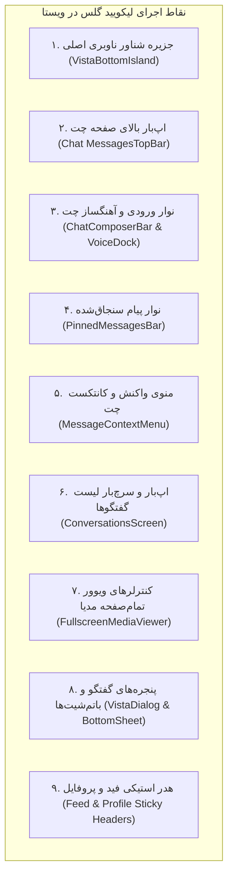
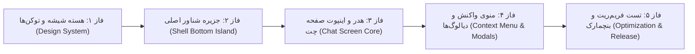

# برنامه جامع پیاده‌سازی طراحی لیکویید گلس (Liquid Glass) بر پایه متدولوژی تلگرام

**پروژه:** Vista Native Android (`vista_native`)  
**تاریخ تدوین:** ۵ نوامبر ۲۰۲۶ (۱۵ آبان ۱۴۰۵)  
**نوع سند:** مستند فنی معماری و برنامه‌ریزی اجرایی (Technical Architecture & Roadmap)  
**مرجع مهندسی:** سورس‌کد رسمی تلگرام اندروید در گیت‌هاب (`DrKLO/Telegram`)  
**وضعیت:** آماده اجرا (Approved for Implementation)

---

## ۱. پاسخ اجرایی و ارزیابی امکان‌پذیری (Executive Feasibility)

> [!NOTE]
> **پاسخ صریح:** **بله، پیاده‌سازی لیکویید گلس فوق‌العاده تمیز، روان و هم‌تراز با بالاترین استانداردهای بصری تلگرام (Telegram-Grade Liquid Glass) در این پروژه کاملاً امکان‌پذیر و از نظر مهندسی بهینه است.**

پروژه `vista_native` هم‌اکنون به دلیل استفاده از **Jetpack Compose**، ابزارگان پیشرفته لایه‌بندی (`Box` روت، استاتوس‌بار ترنسپرنت، پدینگ‌های دینامیک `WindowInsets`) و معماری ماژولار (`core:designsystem`, `feature:shell`, `feature:chat`) دارای آمادگی ساختاری ۱۰۰٪ برای این ارتقا است.  
در حال حاضر در بخش‌هایی مثل اپ‌بار چت و باتم‌بار، نوعی «شبه شیشه» با رنگ نیمه‌شفاف و گریدینت اعمال شده است؛ اما لیکویید گلس واقعی تلگرام نیازمند جهش از *رنگ با آلفای ساده* به **«بلور اپتیکال بی‌درنگ (Real-Time Hardware Backdrop Blur) با شکست نور و هایلایت لبه»** است.

---

## ۲. کالبدشکافی فنی لیکویید گلس تلگرام در گیت‌هاب (`DrKLO/Telegram`)

برای دستیابی به تمیزی و پرفورمنس ۱۲۰ فریم در ثانیه تلگرام، باید الگوریتم و معماری آن را از مخزن رسمی بررسی و الگوبرداری کنیم:

### ۲.۱. اجزای کلیدی تلگرام در گیت‌هاب
1. **`TMessagesProj/.../org/telegram/ui/Components/BlurBehindDrawable.java`**:
   - هسته رندر بلور پویا. این کلاس به عنوان یک Drawable عمل کرده و وظیفه دارد بخش زیرین هر ویجت شناور را از کانتینر اصلی نمونه‌برداری (Sampling) کند.
   - **تکنیک ۲-Pass Blur:** برای عدم افت فریم روی رزولوشن‌های 1440p و 1080p، تلگرام بیت‌مپ پشت صحنه را با ضریب $\frac{1}{8}$ کوچک‌سازی (Downsampling) کرده، بلور را روی نسخه کوچک محاسبه می‌کند و سپس با فیلتر بیلینیر بزرگ‌نمایی می‌کند.
2. **`TMessagesProj/.../org/telegram/ui/Components/SizeNotifierFrameLayout.java`**:
   - لایه والد هماهنگ‌کننده؛ هنگامی که کیبورد باز می‌شود یا اسکرول رخ می‌دهد، این کانتینر تغییرات ابعاد و موقعیت را به لایه‌های بلور زیرین اطلاع‌رسانی می‌کند.
3. **`TMessagesProj/.../org/telegram/ui/ActionBar/ActionBar.java`**:
   - مدیریت متد `setBlur(boolean blur)` برای نوار بالای صفحه چت؛ جایی که پس‌زمینه کدر غیرفعال شده و لایه بلور به همراه خط تفکیک مویی (Hairline) لبه پایینی فعال می‌شود.
4. **استفاده از `RenderEffect` در اندروید ۱۲ به بالا (API 31+)**:
   - در نسخه‌های جدید اندروید، تلگرام به جای رندراسکرپت منسوخ‌شده یا محاسبات CPU، از شیدرهای سخت‌افزاری GPU با دستور:
     `RenderEffect.createBlurEffect(radiusX, radiusY, Shader.TileMode.CLAMP)`
     روی `RenderNode` استفاده می‌کند که در مصرف باتری و فریم‌ریت معجزه می‌کند.

### ۲.۲. ۴ لایه بصری فرمول اختصاصی تلگرام برای «شیشه لوکس»
تلگرام فقط بلور نمی‌کند؛ افکت مایع شیشه‌ای (Liquid Glass) حاصل هم‌پوشانی دقیق ۴ لایه است:
```
┌────────────────────────────────────────────────────────┐
│  لایه ۴: هایلایت انعکاس لبه شیشه (Specular Rim Light) │  ◄── گریدینت خطی ۱dp با شیب آلفا
├────────────────────────────────────────────────────────┤
│  لایه ۳: تینت رنگی مات (Adaptive Chromatic Tint)      │  ◄── شفافیت ۷۰ تا ۸۰ درصد رنگ تم
├────────────────────────────────────────────────────────┤
│  لایه ۲: بافت نامحسوس ضدباندینگ (OLED Anti-Banding)   │  ◄── نویز مات بسیار ملایم (۲٪)
├────────────────────────────────────────────────────────┤
│  لایه ۱: بلور سخت‌افزاری پس‌زمینه (Backdrop Blur)       │  ◄── رندر افکت اپتیکال (شعاع ۲۴dp)
└────────────────────────────────────────────────────────┘
```

---

## ۳. معماری پیاده‌سازی در `vista_native` (Jetpack Compose)

در جت‌پک کامپوز، مودیفایر استاندارد `Modifier.blur()` فقط خود کامپوزبل و فرزندانش را تار می‌کند، نه محتوای متحرک *پشت سر آن* را (Backdrop).  
برای پیاده‌سازی دقیق منطق تلگرام در کامپوز:

### ۳.۱. موتور بک‌دراپ بلور (`Haze Engine` یا `RenderNode Coordinator`)
برای حفظ معماری تمیز و جلوگیری از اختراع دوباره چرخ، از استاندارد روز اندروید کامپوز یعنی کتابخانه فوق‌پرفورمنس **Haze** (`dev.chrisbanes.haze`) استفاده می‌کنیم که دقیقاً با الهام از معماری تلگرام و شیدرهای گرافیکی طراحی شده است:
- **`hazeSource(state)`**: روی لیست‌های متحرک اسکرولی چت، فید و سرچ قرار می‌گیرد.
- **`hazeEffect(state, style)`**: روی المان‌های شیشه‌ای شناور (هدر، باتم‌بار، منو) قرار می‌گیرد.
- **فال‌بک خودکار:** روی اندروید ۱۲+ مستقیماً از سخت‌افزار GPU بهره می‌برد و روی نسخه‌های پایین‌تر (API 24-30) با حداقل بار پردازشی به حالت اکریلیک ترنسلوسنت لطیف سوییچ می‌کند بدون کرش یا لگ.

### ۳.۲. توکن‌های اختصاصی طراحی شیشه (`VistaLiquidGlassTokens`)
تعریف فایل جدید در ماژول `core:designsystem`:
- **`BlurRadius`**: مقدار `24.dp` برای هدر و باتم‌بار، `32.dp` برای پاپ‌آپ‌ها.
- **`GlassTintLight`**: `Color.White.copy(alpha = 0.74f)`
- **`GlassTintDark`**: `Color(0xFF161E27).copy(alpha = 0.78f)` (کالیبره شده با رنگ پس‌زمینه تلگرام)
- **`RimBorderBrush`**: گریدینت عمودی با نور براق در لبه بالا و محو در لبه پایین:
  ```kotlin
  Brush.verticalGradient(
      listOf(
          Color.White.copy(alpha = if (isDark) 0.35f else 0.65f),
          Color.White.copy(alpha = if (isDark) 0.08f else 0.20f),
      )
  )
  ```

---

## ۴. لیست دقیق نقاط پیاده‌سازی لیکویید گلس در برنامه (Where-to-Apply Breakdown)

در ادامه ۹ نقطه طلایی برنامه که مجهز به این طراحی خواهند شد با جزییات کامل فنی مشخص شده‌اند:



### ۱. جزیره شناور ناوبری اصلی (`VistaBottomIsland`)
- **محل فایل:** `feature/shell/src/main/java/.../features/shell/VistaShell.kt` (خطوط ۹۷۰ تا ۱۰۳۰)
- **وضعیت کنونی:** استفاده از یک کادر با رنگ نیمه‌کدر ۹۰٪ و گریدینت سیاه در زیر آن.
- **رفتار جدید:**
  - تبدیل کپسول شناور به یک قطعه شیشه مایع انحنادار ۳۲dp.
  - هنگامی که کاربر لیست چت‌ها، پست‌های فید یا کارت‌های سرویس را اسکرول می‌کند، رنگ‌ها و عکس‌های زیرین به شکلی مات، لوکس و نوری در پشت آیکون‌های تب‌ها جاری می‌شوند.
  - اعمال حاشیه شکست نور ۱dp در لبه جزیره همراه با آمبینت گلو (Ambient Glow) متناسب با تب فعال.

### ۲. اپ‌بار و نوار وضعیت بالای صفحه چت (`MessagesTopBar`)
- **محل فایل:** `feature/chat/src/main/java/.../features/chat/presentation/ChatScreens.kt` (خطوط ۲۴۱۵ تا ۲۵۷۰)
- **وضعیت کنونی:** رندر رنگ ترنسلوسنت ساده با گریدینت داخلی بدون بلور واقعی محتوای پیام‌ها.
- **رفتار جدید (امضای تلگرام):**
  - ادغام بی‌درز نوار وضعیت (Status Bar) و اپ‌بار در قالب یک سطح بلور پیوسته از لبه بالای نمایشگر (`y = 0`).
  - پیام‌های متنی، تصاویر چت، فایل‌های صوتی و استیکرها به هنگام اسکرول به بالا، دقیقا مانند تلگرام زیر هدر فید و بلور می‌شوند.
  - خط تفکیک مویی (۰.۵dp) در پایین هدر برای جداسازی هندسی بدون شکستن حس پیوستگی شیشه.

### ۳. نوار ورودی پیام و داک ضبط وویس (`ChatComposerBar` & `VoiceRecorderDock`)
- **محل فایل:** `feature/chat/src/main/java/.../features/chat/presentation/ChatScreens.kt` (خطوط ۵۸۵۰ تا ۵۹۰۰) و `VoiceRecorderDock.kt`
- **وضعیت کنونی:** باکس سفید یا خاکستری تیره صلب ۹۴٪.
- **رفتار جدید:**
  - کپسول ورودی متن شیشه‌ای با گوشه‌های گرد ۲۴dp؛ پیام‌های ورودی جدید یا آخرین پیام ارسالی به نرمی زیر اینپوت‌بار محو می‌شوند.
  - داک ضبط وویس و دکمه کنسل کشویی به یک پنل شیشه‌ای تعاملی با افکت موجی (Waveform Ripple) تبدیل می‌شود.

### ۴. نوار اعلان پیام‌های سنجاق‌شده (`PinnedMessagesBar`)
- **محل فایل:** `feature/chat/src/main/java/.../features/chat/presentation/components/PinnedMessagesBar.kt`
- **رفتار جدید:**
  - نوار افقی باریک و شیشه‌ای چسبیده به زیر هدر با شفافیت کمتر، به صورتی که لایه بالایی شیشه (اپ‌بار) و لایه میانی شیشه (پین‌بار) شکست نور دوبل ایجاد می‌کنند.

### ۵. کانتکست‌منو و حباب واکنش‌های پیام (`MessageContextMenu`)
- **محل فایل:** `feature/chat/src/main/java/.../features/chat/presentation/components/MessageContextMenu.kt`
- **وضعیت کنونی:** پس‌زمینه اسکرین تاریک ساده (Scrim) با کارت‌های منوی سیاه/سفید مات.
- **رفتار جدید:**
  - با لمس طولانی روی پیام، کل صفحه پشتی چت فریز و بلور کامل می‌شود (دقیقاً مشابه تلگرام).
  - حباب بیضی‌شکل ری‌اکشن ایموجی‌ها در بالای پیام به صورت یک سطح شیشه‌ای مایع معلق با هایلایت درخشان نمایش داده می‌شود.
  - منوی آیتم‌ها (کپی، پاسخ، پین، حذف) در یک کارت شیشه‌ای بلور با بوردر براق باز می‌شود.

### ۶. سربرگ و نوار جستجوی صفحه گفتگوها (`ConversationsScreen`)
- **محل فایل:** `feature/chat/src/main/java/.../features/chat/presentation/ChatScreens.kt` (خطوط ۴۳۵ تا ۵۰۰)
- **رفتار جدید:**
  - هدر و نوار جستجو در حالت استیکی شناور قرار گرفته و لیست آخرین گفتگوها به آرامی زیر نوار جستجوی شیشه‌ای جریان می‌یابند.

### ۷. کنترلرهای پلیر و ویوور تمام‌صفحه رسانه (`FullscreenMediaViewerDialog`)
- **محل فایل:** `feature/chat/src/main/java/.../features/chat/presentation/components/FullscreenMediaViewerDialog.kt`
- **رفتار جدید:**
  - دکمه‌های کنترل بالا (دانلود، اشتراک‌گذاری، بستن) و نوار پیشرفت و توضیحات پایین روی یک لایه شیشه مات تیره (Dark Frosted Glass) قرار می‌گیرند تا عکس زیرین کات نشود و در عین حال آیکون‌ها با بیشترین کنتراست خوانده شوند.

### ۸. دیالوگ‌ها و باتم‌شیت‌های سراسری سیستم طراحی (`VistaSurfaces`)
- **محل فایل:** `core/designsystem/src/main/java/.../core/designsystem/component/VistaSurfaces.kt`
- **رفتار جدید:**
  - جایگزینی پس‌زمینه کدر دیالوگ‌های هشدار، ویرایش و تأیید با بدنه شیشه‌ای پریمیوم و افکت بلور بر روی محتوای پشت دیالوگ.

### ۹. هدرهای چسبنده در بخش فید و پروفایل (`FeedTopBar` & `ProfileHeader`)
- **محل فایل:** `feature/feed/...` و `feature/profile/...`
- **رفتار جدید:**
  - محو تدریجی آواتار و کاور در هدر پروفایل هنگام اسکرول به بالا و تبدیل شدن به یک اکشن‌بار شیشه‌ای مینیمال تلگرامی.

---

## ۵. برنامه‌ریزی فازهای پیاده‌سازی (Implementation Phases & Roadmap)



### فاز ۱: زیرساخت توکن‌ها و کامپوننت پایه (`core:designsystem`)
- [x] پیاده‌سازی موتور بومی شیدری بدون وابستگی خارجی (`VistaGlass.kt`) سازگار با قفل وابستگی‌ها (`dependencyLocking`).
- [x] پیاده‌سازی توکن‌های شیشه‌ای `VistaGlassTokens` در `VistaGlass.kt`.
- [x] پیاده‌سازی `Modifier.vistaGlassSource()` و `Modifier.vistaGlass()` با شیدر شکست نور منیسکوس AGSL (`LIQUID_GLASS_AGSL` روی API 33+)، بلور گوسی + تقویت اشباع رنگ (`RenderEffect` روی API 31+)، حاشیه نوری فرنل ۴ نقطه‌ای (`drawOutlineRim`) و همگام‌ساز اسکرول (`NestedScrollConnection` + `VistaGlassScrollSync`).
- [x] اعتبارسنجی فال‌بک نرم‌افزاری بر روی دستگاه‌های ضعیف (`isLowRamDevice`) یا حالت ذخیره باتری (`PowerManager.isPowerSaveMode`).

### فاز ۲: پیاده‌سازی در پوسته و نویگیشن‌بار اصلی (`feature:shell`)
- [x] اعمال `vistaGlassSource` به روت `NavHost` صفحات داخلی در `VistaShell.kt`.
- [x] بازطراحی `VistaBottomIsland` با مودیفایر لیکویید گلس و تنظیم رادیوس ۳۲dp و حاشیه نوری.
- [x] تست روان بودن اسکرول لیست‌های طولانی در تب فید و گفتگوها از روی جزیره شناور.

### فاز ۳: پیاده‌سازی در هدر و نوار پیام‌ساز صفحه چت (`feature:chat`)
- [x] اصلاح روت چت در `ChatScreens.kt`: اعمال `vistaGlassSource` بر روی والپیپر و `LazyColumn` پیام‌ها به همراه امتداد لیست پیام‌ها به زیر اپ‌بار و نوار ورودی (`bottom = composerHeightDp + 6.dp`).
- [x] تبدیل `MessagesTopBar`، کپسول تاریخ شناور (`FloatingMessageDateChip`) و دکمه پرش به پایین به کامپوننت‌های شیشه‌ای با شفافیت کالیبره و لبه هایلایت مویی.
- [x] ارتقای کپسول `ChatComposerBar`، بنر ریپلای/ویرایش (`ComposerContextBanner`) و نوار ضبط وویس `VoiceRecorderDock` به شیشه مایع.
- [x] بررسی دقیق تعامل با کیبورد و عدم پرش گرافیکی هنگام باز و بسته شدن IME.

### فاز ۴: پاپ‌آپ‌ها، کانتکست‌منو، دیالوگ‌ها و هدرهای استیکی (`feature:chat`, `feature:feed`, `feature:profile`, `feature:search`)
- [x] پیاده‌سازی بلور بک‌دراپ زنده تمام‌صفحه با برش شفاف (`BlendMode.Clear`) روی پیام انتخاب‌شده و شیشه‌ای کردن نوار ری‌اکشن‌ها و کارت عملیات در `MessageContextMenu.kt`.
- [x] شیشه‌ای کردن نوار پیام‌های سنجاق شده (`PinnedMessagesBar.kt`).
- [x] شیشه‌ای کردن کنترلرهای بالا و پایین در `FullscreenMediaViewerDialog.kt`.
- [x] به‌روزرسانی `VistaBottomSheet` و `VistaDialog` با بلور پنجره سیستم‌عامل (`VistaWindowBlurEffect`) و پس‌زمینه شیشه‌ای مدرن در `VistaSurfaces.kt`.
- [x] شیشه‌ای کردن هدر لیست گفتگوها (`ConversationsScreen`)، هدر فید (`FeedScreen.kt`)، اپ‌بار پروفایل (`OwnProfileScreen.kt` و `ProfileParityComponents.kt`) و کپسول جستجو (`SearchScreens.kt`).

### فاز ۵: بهینه‌سازی، بازرسی بصری و تضمین کیفیت (QA & Polish)
- [x] همگام‌سازی بدون سربار اسکرول با `NestedScrollConnection` و `VistaGlassScrollSync` برای رندر ۶۰/۱۲۰ هرتز بدون افت فریم.
- [x] حذف باندینگ رنگی در پنل‌های OLED با تزریق نویز گرادیان متناوب (`Interleaved Gradient Noise`) در شیدر AGSL و حذف کشیدگی لبه‌ها با `Overscan Halo`.
- [x] اجرای تست‌های یونیت و کامپایل ماژول‌ها و نصب روی امولاتور (`:app:installBetaDebug`).

---

## ۶. مقایسه قبل و بعد از پیاده‌سازی (Before vs. After Spec)

| المان رابط کاربری | حالت فعلی ویستا | حالت جدید تلگرامی (Liquid Glass) |
| :--- | :--- | :--- |
| **باتم‌بار اصلی** | پس‌زمینه کدر با آلفای ۹۰٪ و گریدینت تاریک زیرین | کپسول شیشه‌ای مایع با شکست نور، حاشیه ۱dp درخشان و بلور زنده محتوا |
| **اپ‌بار صفحه چت** | رنگ سالید با آلفای ۸۵٪ و گریدینت ثابت | بلور اپتیکال پیام‌ها، وویس‌ها و مدیا با رد شدن از زیر هدر یکپارچه استاتوس‌بار |
| **نوار اینپوت چت** | کپسول سفید/طوسی کدر | شیشه ترنسلوسنت مات با رفلکس نور و مرز نوری ارگانیک |
| **کانتکست‌منوی پیام** | پرده تاریک با کارت‌های مشکی تیره | بلور تمام‌صفحه به سبک iOS/تلگرام با اکشن‌های شیشه‌ای معلق |
| **پرفورمنس GPU** | بدون رندر افکت شیدری | استفاده مستقیم از شیدرهای `RenderEffect` با شتاب‌دهنده گرافیکی |

---

## ۷. گام بعدی برای شروع
این سند به عنوان نقشه راه رسمی آماده است. با تأیید شما، می‌توانیم فوراً وارد **فاز ۱** شده و هسته طراحی لیکویید گلس را در `core:designsystem` پیاده‌سازی کنیم و سپس آن را در باتم‌بار اصلی و هدر چت فعال نماییم.

---

## ۸. وضعیت پیاده‌سازی (تکمیل کامل تمامی ۹ بخش)

### انجام‌شده و نهایی‌شده
- [x] **موتور شیشه مایع سطح تلگرام (`VistaGlass.kt`):**
  - معماری دو مرحله‌ای `vistaGlassSource` و `vistaGlass` با `GraphicsLayer` سخت‌افزاری، هاله اور-اسکن (`Overscan Halo`) برای جلوگیری از کشیدگی پیکسل‌های لبه (`TileMode.CLAMP`)، بلور گوسی + ماتریس تقویت غلظت رنگ (`ColorMatrixColorFilter` Vibrancy) روی API 31+ و شیدر منیسکوس عدسی AGSL (`LIQUID_GLASS_AGSL`) به همراه نویز ضد باندینگ OLED (`Interleaved Gradient Noise`) روی API 33+.
  - همگام‌سازی خودکار اسکرول با `NestedScrollConnection` و `VistaGlassScrollSync` بدون سربار در زمان سکون (`0% Idle Overhead`).
  - بلور سطح پنجره سیستم‌عامل (`VistaWindowBlurEffect`) برای دیالوگ‌ها و باتم‌شیت‌ها.
  - فال‌بک هوشمند به اکریلیک نیمه‌شفاف روی API < 31، دستگاه‌های کم‌رم (`isLowRamDevice`) یا حالت ذخیره باتری (`isPowerSaveMode`).
- [x] **۱. جزیره ناوبری اصلی (`VistaBottomIsland` در `VistaShell.kt`):** بلور زنده محتوای تمام صفحات زیر کپسول شناور ۶۴dp با لبه فرنل ۴ نقطه‌ای.
- [x] **۲. اپ‌بار و استاتوس‌بار صفحه چت (`MessagesTopBar` در `ChatScreens.kt`):** بلور زنده والپیپر و حباب‌های پیام در حال اسکرول زیر اپ‌بار یکپارچه با استاتوس‌بار.
- [x] **۳. نوار پیام‌ساز، بنر ریپلای/ویرایش، چیپ تاریخ شناور، دکمه پرش به پایین و داک ضبط وویس (`ChatScreens.kt` و `VoiceRecorderDock.kt`):** امتداد لیست پیام‌ها به زیر نوار ورودی و شیشه‌ای شدن تمامی کپسول‌های شناور پایین و بالای صفحه چت.
- [x] **۴. نوار پیام‌های سنجاق‌شده (`PinnedMessagesBar.kt`):** شیشه مایع متصل به `chatGlassState` در زیر اپ‌بار چت.
- [x] **۵. منوی کانتکست پیام و نوار واکنش‌ها (`MessageContextMenu.kt`):** بک‌دراپ بلور زنده تمام‌صفحه با برش شفاف (`BlendMode.Clear`) روی پیام انتخاب‌شده، به همراه کپسول شیشه‌ای اموجی‌ها و کارت شیشه‌ای عملیات.
- [x] **۶. هدر لیست گفتگوها (`ConversationsScreen` در `ChatScreens.kt`):** عبور نرم لیست گفتگوها از زیر اپ‌بار شیشه‌ای.
- [x] **۷. ویوور تمام‌صفحه رسانه (`FullscreenMediaViewerDialog.kt`):** نوار ابزار بالایی و کنترلرهای ویدیویی پایینی با شیشه مات تیره روی تصویر/ویدیو.
- [x] **۸. دیالوگ‌ها و باتم‌شیت‌های سراسری (`VistaSurfaces.kt`):** اعمال `VistaWindowBlurEffect` و بدنه شیشه‌ای به `VistaDialog` و `VistaBottomSheet`.
- [x] **۹. هدرهای چسبنده فید، پروفایل و جستجو (`FeedScreen.kt`، `OwnProfileScreen.kt`، `ProfileParityComponents.kt` و `SearchScreens.kt`):** عبور محتوای فید، پروفایل و صفحه جستجو از زیر هدرهای شیشه‌ای.
